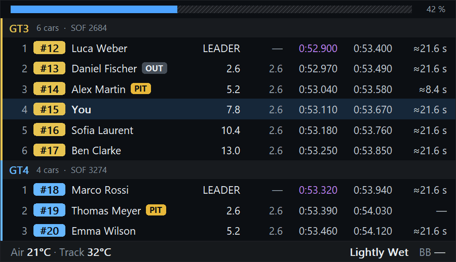
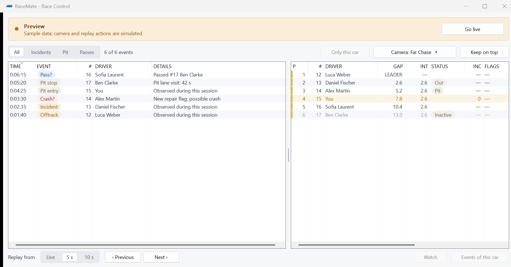

# RaceMate

**Native iRacing overlays, fuel strategy and race monitoring for Windows.**

RaceMate puts nearby traffic, standings, fuel planning, weather, pit-limiter warnings and a track map on screen, with a separate Race Control window for events and replay navigation. It is built with C++20, Win32 and GDI/GDI+: one executable with a statically linked runtime and no browser engine.

[**Download releases**](https://github.com/gaggi/RaceMate/releases) · [**Documentation**](docs/README.md) · [**First setup**](docs/getting-started.md) · [**Build from source**](docs/development.md)

> These guides describe **version 0.2.2**. Screenshots show the real application with diagnostic sample data and selected optional features enabled.
>
> Reading this README from a release ZIP? Open the [full documentation on GitHub](https://github.com/gaggi/RaceMate/tree/main/docs).

## At a glance

| Standings | Track Map |
| --- | --- |
|  |  |
| Class sections, live position estimates and configurable columns. | Official Map, Circle or Line, with optional transparent presentation. |

| Feature | What it provides |
| --- | --- |
| **Relative** | Nearby cars centered on your car or the car you watch |
| **Standings** | Class or combined order, gaps, intervals, lap times and optional pit/driver information |
| **Fuel Calculator** | Learned consumption, range, refueling, pit windows and fuel targets |
| **Pit Assist** | Limiter state, pit lane progress with your box and brake points, pit-exit warning and setup differences |
| **Weather** | Current conditions, temperature history, trends and car-relative wind |
| **Track Map — experimental** | Official circuit geometry or download-free Circle/Line layouts |
| **Side Warning** | Bars at the screen edges while a car is beside you, from iRacing's spotter |
| **Radar** | The cars around yours from above, with exact distances and lanes estimated from the spotter |
| **Traffic** | Faster cars close behind you in multiclass races, with their gap |
| **Race Control** | Observed incidents, pit visits and estimated passes, with camera/replay navigation |
| **Layouts** | Independent arrangements that switch for driving, spectating or the garage |

## Get started

1. Download the matching Windows executable or ZIP from [Releases](https://github.com/gaggi/RaceMate/releases). Use x64 for a 64-bit Windows installation.
2. Put it in a stable, user-writable folder and launch it. RaceMate supports **Windows 10/11** and does not need a separate runtime installation.
3. Click **Preview** to configure overlays with sample data, without joining iRacing.
4. Enable **Move overlays**, drag the panels into place and click **Done**. Expand an overlay row for size, opacity, fixed corner and refresh rate; choose **Settings** for its contents.
5. Turn Preview off, run iRacing in **borderless windowed mode** and join a session. RaceMate connects automatically.

Outside Move mode, overlays pass mouse clicks through and do not take focus. They follow the camera car while spectating/replaying where the data supports it, and hide on disconnection unless Preview is active. Pit Assist appears under its own driving/pit conditions.

Read the illustrated [Getting started guide](docs/getting-started.md) for installation, connection, updates and daily use.

## Race Control



Review observed events beside full standings, filter by category or car, and jump to five or ten seconds before an event. Camera and replay controls operate when you are out of the car. The event feed retains up to 2,000 events for the current session; possible crashes and passes are explicitly estimated.

The [Race Control guide](docs/race-control.md) explains filtering, optional columns, sorting, the resizable table split and replay-buffer limits.

## Make it your own

Every overlay has independent content, size, opacity, refresh rate and a fixed corner for resizing. Headers and footers each hold up to four selectable metrics. Add more Relative, Standings, Fuel Calculator, Weather or Track Map instances, and save different arrangements as layouts.

Layouts switch automatically by priority when you enter the car, leave it or open the garage. Settings are saved immediately to `%LOCALAPPDATA%\RaceMate\settings.ini`. Closing the main window normally keeps RaceMate in the tray; choose **Exit** there to quit.

Global, configurable shortcuts move and hide the overlays, open the settings and step through Race Control events; see [keyboard shortcuts](docs/layouts-and-settings.md#keyboard-shortcuts). [Layouts and settings](docs/layouts-and-settings.md) also covers automatic selection, startup, backups and customization.

## Understand the estimates

Fuel consumption is learned from complete eligible laps. Finish distance, pit exit positions, opponent END/SAVE badges and iRating changes are forecasts with specific assumptions. Competitors' actual fuel is unavailable; future competitor stops are not automatically included. The official Track Map's car projection is experimental.

The [Fuel and pit strategy guide](docs/fuel-and-pit-strategy.md) explains the numbers, sample requirements and limits. The [Track Map guide](docs/track-map.md) covers layout identity, transparency, labels, downloads and projection behavior.

Telemetry is read locally from iRacing's shared memory. Race Control can send camera/replay commands through iRacing's Windows message interface. Optional update checks/downloads use GitHub, and uncached official maps use iRacing's public asset server. Cached maps work offline; Circle and Line need no map download.

## Documentation

| Guide | Contents |
| --- | --- |
| [Documentation index](docs/README.md) | All user and developer guides |
| [Getting started](docs/getting-started.md) | Requirements, first launch and connection |
| [Overlay reference](docs/overlays.md) | All overlays, columns, status badges and header/footer metrics |
| [Layouts and settings](docs/layouts-and-settings.md) | Layout priority, additional instances, appearance and shortcuts |
| [Fuel and pit strategy](docs/fuel-and-pit-strategy.md) | Learning, forecasts, opponent range and pit exit estimates |
| [Track Map](docs/track-map.md) | Map, Circle, Line, labels, cache and experimental limits |
| [Race Control](docs/race-control.md) | Events, filters, standings, cameras and replays |
| [Troubleshooting](docs/troubleshooting.md) | Missing overlays/data, connection, maps and updates |
| [Development](docs/development.md) | Builds, tests, diagnostics, profiling and releases |
| [Architecture](docs/architecture.md) | Source map, data flow, rendering and persistence |

## Build

Install Visual Studio 2022 Build Tools with **Desktop development with C++**, a Windows SDK and CMake support. From the repository root:

```powershell
.\build.ps1                         # x64 Release, tests and dist/x64 package
.\build.ps1 -Architecture Win32     # x86 build and tests
.\build.ps1 -Diagnostics            # Also run native GUI diagnostics
```

See [Development](docs/development.md) for the full workflow and screenshot regeneration. Diagnostic sample settings and output live in the ignored `build/qa` directory, separate from personal settings.

## Credits and references

- [Third-party notices](docs/third-party.md) cover NanoSVG, the map index and official iRacing assets.
- [iRacing shared-memory definitions](https://github.com/vipoo/irsdk/blob/master/irsdk_defines.h), [session YAML reference](https://sajax.github.io/irsdkdocs/yaml/sessioninfo.html) and [YawNorth documentation](https://sajax.github.io/irsdkdocs/telemetry/yawnorth.html) provide protocol background.
- [Slipstream](https://github.com/antonholovko-cloud/Slipstream) served as a functional reference; no code was copied.

RaceMate is an independent project and is not provided or endorsed by iRacing.
