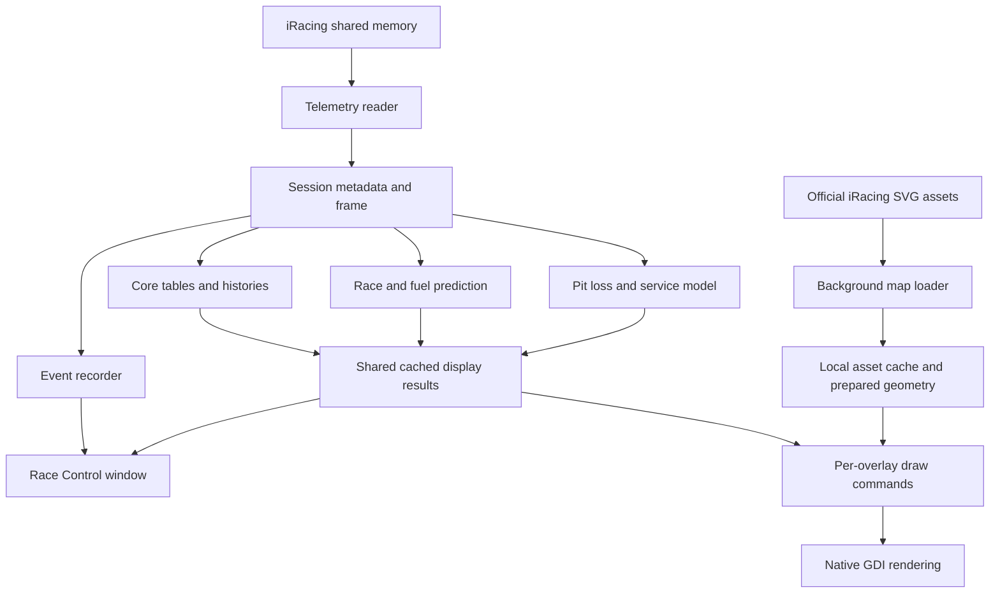

# Architecture

[Documentation](README.md) · [Development](development.md)

RaceMate is a native Windows application. The production program combines a telemetry-independent analysis library with a Win32 UI, overlay renderer, shared-memory reader and small HTTPS workers. It uses C++20 and statically links the MSVC runtime.

## Data flow

The shared-memory mapping is opened for read access. Race Control separately uses iRacing's supported Windows broadcast-message mechanism for requested camera/replay actions. Reading telemetry does not modify the shared-memory buffers.

## Source map

| File or directory | Responsibility |
| --- | --- |
| [`src/Core.h`](../src/Core.h), [`src/Core.cpp`](../src/Core.cpp) | Session/frame types, metadata parsing, table selection, histories, fuel model and shared helpers |
| [`src/Telemetry.h`](../src/Telemetry.h), [`src/Telemetry.cpp`](../src/Telemetry.cpp) | Shared-memory protocol, connection, variable lookup, stable frame copy and session parsing |
| [`src/Prediction.cpp`](../src/Prediction.cpp) | Race finish projection and opponent fuel status |
| [`src/PitStop.cpp`](../src/PitStop.cpp) | Learned pit loss, refuel rate, planned service and rejoin predictions |
| [`src/RaceControl.h`](../src/RaceControl.h), [`src/RaceControl.cpp`](../src/RaceControl.cpp) | Event recording and camera/replay message construction |
| [`src/main.cpp`](../src/main.cpp) | Application state, overlay settings, model caches, rendering, telemetry tick and process/window lifecycle |
| [`src/MainWindow.inc`](../src/MainWindow.inc), [`src/OverlaysPage.inc`](../src/OverlaysPage.inc) | Main shell, navigation, layout/instance and placement controls |
| [`src/TablePage.inc`](../src/TablePage.inc), [`src/ElementsPage.inc`](../src/ElementsPage.inc), [`src/Bands.inc`](../src/Bands.inc), [`src/Footer.inc`](../src/Footer.inc) | Overlay content pages and shared header/footer rendering |
| [`src/RaceControl.inc`](../src/RaceControl.inc), [`src/RaceControlFields.inc`](../src/RaceControlFields.inc), [`src/RaceControlPage.inc`](../src/RaceControlPage.inc) | Race Control window, fields, sorting, filters and replay interaction |
| [`src/GeneralPage.inc`](../src/GeneralPage.inc), [`src/Settings.inc`](../src/Settings.inc) | Global settings, shortcut editing and Windows startup registration |
| [`src/TrackMap.cpp`](../src/TrackMap.cpp), [`src/TrackMap.h`](../src/TrackMap.h) | SVG interpretation and geometric projection |
| [`src/TrackMapLoader.cpp`](../src/TrackMapLoader.cpp), [`src/TrackMapSources.inc`](../src/TrackMapSources.inc) | Official asset retrieval, cache handling and generated layout index |
| [`src/TrackMap.inc`](../src/TrackMap.inc), [`src/TrackMapScene.inc`](../src/TrackMapScene.inc), [`src/TrackMapLabels.inc`](../src/TrackMapLabels.inc), [`src/TrackMapPage.inc`](../src/TrackMapPage.inc) | Map runtime, scenes, labels and user controls |
| [`src/update`](../src/update), [`src/Updates.inc`](../src/Updates.inc) | GitHub release parsing, downloads, executable replacement and update UI |
| [`src/ui`](../src/ui) | Native reusable list, page, navigation, editor and background-task components |
| [`src/Diagnostics.inc`](../src/Diagnostics.inc) | Native render captures and GUI regression checks, compiled only for diagnostics |
| [`tests`](../tests) | Core, telemetry, prediction, event, service, update and map regression tests |
| [`resources`](../resources) | Windows resources, icons, logo sources and packed atlas |

The `.inc` files are included into the application translation unit, often within its private namespace. They are organized source fragments, not independent libraries or separate CMake targets. Consult the include order in `main.cpp` when changing shared UI helpers.

## Telemetry lifecycle

`Telemetry` reads `Local\IRSDKMemMapFileName`. It resolves needed variables once per connection instead of looking up names every frame, validates buffer ranges and copies a frame before interpreting it. The wire structures have explicit size checks. Missing variables use model fallbacks or unknown values.

Session YAML is parsed only when its update marker or relevant session identity changes. Live telemetry and session results are combined for lap data, which lets standings display known laps from before RaceMate joined.

The application tick updates shared histories and invalidates/caches derived results. Optional calculations, such as opponent fuel and rating changes, are requested when a displayed field needs them. This avoids recomputing the same field model for multiple overlays and Race Control.

Model histories distinguish driving, live spectating and historical replay. Fuel consumption and opponent stint evidence do not learn from replay movement. Weather collection pauses for historical footage. Incident points arriving through live session info remain associated with live session time.

## Rendering and scheduling

`TelemetryPump` reads iRacing on a thread of its own. It waits for iRacing's data-valid event (`Local\IRSDKDataValidEvent`), so it reads each of iRacing's 60 frames a second as it appears, copies it and posts a message to the main window; the main thread takes the newest frame, never a queue, and runs the analyses on it. Session YAML is parsed on that thread too. A window timer would only fire in steps of about 15.6 ms: a 50 ms timer gave 16 ticks a second, not 20.

Each overlay has its own rate and refreshes on whole iRacing frames, every `60 / rate` frames, so a 15 Hz overlay is drawn every 66.7 ms exactly. In the preview, a window timer at the fastest overlay rate sets the pace instead. Without iRacing, the thread looks for it about once a second; when frames pause, a 250 ms timer keeps the window current.

Overlay content becomes a list of draw commands. RaceMate compares scenes, retains buffers and repaints changed areas. Windows handles normal click-through overlay windows without activation; Move mode changes hit testing so the user can drag them. Separate borders identify content selection and movement.

Maps additionally cache static map bitmaps by overlay/size/style, prepared geometry, marker graphics and label text. Moving cars are blended into a copy of the map area. Transparent-map mode uses per-pixel alpha, while the framed panel uses normal overlay opacity.

Normal startup requests idle process priority and execution-speed power throttling (EcoQoS). This is a scheduling preference, not a fixed CPU or latency guarantee. Use the profiler and benchmarks to measure a specific workload.

## Persistence and layout selection

The normal configuration is `%LOCALAPPDATA%\RaceMate\settings.ini`. Saving updates changed keys and persists placement, layout order, content choices, global preferences and learned/manual pit timing data.

The original layout uses the original plain section names. Additional layouts use prefixes such as `Layout 3:`, and extra instances use numbered names such as `Weather 2`. Keeping the original layout compatible allows earlier settings to migrate without a separate import wizard.

Automatic selection waits until a new situation holds for one second, then uses the first matching layout condition; with none matching, the overlays hide until one does or a layout is chosen by hand. A manual choice lasts until another situation change. GUI diagnostics and benchmarks redirect their configuration to `build/qa/settings.ini`.

## Local files and external access

| Location or integration | Used for |
| --- | --- |
| `%LOCALAPPDATA%\RaceMate\settings.ini` | User preferences, layouts, placements and pit timing values |
| `%LOCALAPPDATA%\RaceMate\trackmaps\v1\<TrackID>` | Official downloaded map layers and cache metadata |
| `%LOCALAPPDATA%\RaceMate\profile.txt` | Latest profiling interval when `--profile` is enabled |
| Temporary `RaceMate-updates/<process-id>` directory | Downloaded update and helper files |
| Current-user Windows Run key | Optional launch at sign-in |
| GitHub API and release downloads | Optional version checks and explicitly initiated updates |
| `members-assets.iracing.com/public/track-maps/` | Official map layers for the Map layout |

Telemetry is processed locally; the implemented network paths retrieve releases and map assets. RaceMate does not require an application account or iRacing credentials for these downloads. Assets remain subject to their owners' terms; see [Third-party notices](third-party.md).

The updater downloads an architecture-specific Windows executable, checks its executable signature bytes and verifies the release asset SHA-256 digest **when metadata provides one**. A helper waits for the application to exit, replaces it and restarts it. Write-protected locations require manual replacement instead.

## Testing boundaries

Core tests can construct sessions and frames without running the simulator. GUI diagnostics exercise native rendering and persistence using sample data. Asset tests validate geometry from local SVG folders. Those checks cannot establish that every schematic marker matches the real simulator at every point; use [in-simulator map validation](track-map-validation.md) for that.

The future assumption model in [Leader-stop scenarios](leader-stop-scenarios.md) is a design proposal. The shipped predictor includes remaining loss for an active pit visit, but does not infer a competitor's future stop as a certain event.
