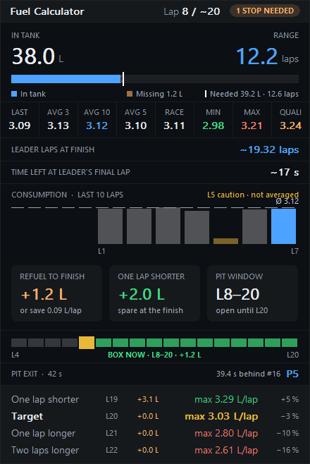
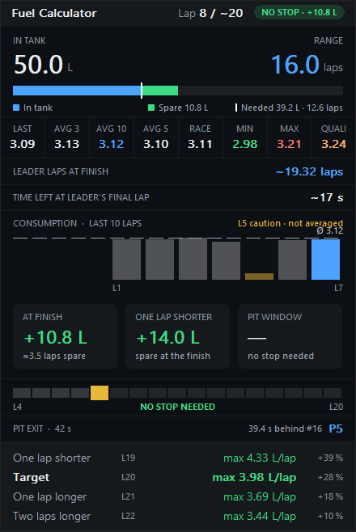
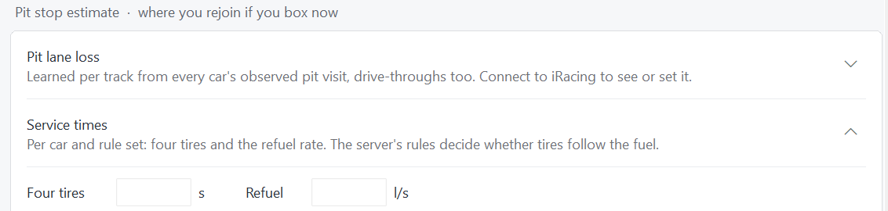

# Fuel and pit strategy

[Documentation](README.md) · [Overlay reference](overlays.md) · [Track Map](track-map.md)

RaceMate derives strategy from observed telemetry. Your current fuel is measured; remaining distance, competitor range and pit exit positions are forecasts. Their assumptions matter most near a lap boundary or a fuel limit.

## Consumption learning

RaceMate measures fuel used between line crossings. A sample must be a complete lap at racing speed. The first partial lap, caution laps, pit laps, out laps, refueling and replay footage do not count toward the average. History resets when the session or car changes; the one exception is **QUALI**, the qualifying maximum, which stays for the race of the same event in the same car. It is kept in memory only: after RaceMate restarts it shows **—** until another qualifying lap.

The **average of the last 10 counted laps** drives range, refuel requirements, the pit window and targets. It can operate with fewer than ten samples: **AVG 10 (3)** means only three eligible laps have been collected. The reduced sample count is shown in gray.

Consumption figures can also show the last lap, 3-lap and 5-lap averages, race average, minimum and maximum. These are selectable display figures; choosing a different visible figure does not replace the 10-lap planning basis.

If consumption stays empty, finish complete green laps without visiting the pits or refueling. A blank value after a session/car change is expected until new valid evidence exists.

## Reading the fuel plan

*1.2 L short of the finish: one stop for +1.2 L, or 0.09 L less per lap; the **Target** row shows the same as a per-lap limit.*

| Element | How to use it |
| --- | --- |
| Tank and range | Compare current fuel with the range calculated from learned consumption |
| Tank bar | The hatched portion represents fuel missing to the finish; the finish mark shows the requirement |
| Refuel to finish | Required additional fuel, **without a safety margin** |
| Orange refuel value | The required fuel can fit in the tank |
| Red refuel value | The requirement exceeds one tank's capacity |
| Pit window | Earliest and latest stop lap under the current plan |
| Timeline | One block per lap of a full-tank stint; current lap yellow, feasible window green |
| Targets | The maximum fuel per lap for the stated stop or finish objective |

The target normally reaches the latest stop, or the finish when no stop is required. **One lap longer**, **Two laps longer** and **One lap shorter** show the per-lap limits for adjacent objectives.

The finish forecast counts no stops still to come. Before the leader has made a stop it must make, the race can run a lap shorter than the forecast, especially when **Time left at leader's final lap** is shorter than a pit stop takes. The **One lap shorter** card shows what to add then: one lap's fuel less at the 10-lap average, or the fuel to spare at the finish when that is enough. It is a module of its own, on by default.

With a pit window open, each target row also shows the fuel to add when you stop on its lap, in orange, such as **+9.4 L**: arriving with the tank empty at that per-lap limit, the fuel for the laps from there to the finish, at the 10-lap average and at most a full tank. Stopping a lap later leaves a lap less to fuel for, so the amount goes down by about one lap's fuel per row. Switch it in the expanded **Target** row; it is on by default.

**QUALI** among the consumption figures is the most fuel a counted lap took in this event's qualifying, in this car. It stays for the race of the same event, as a cautious figure for planning; practice laps don't count towards it. Until you have driven a qualifying lap it shows **—**.

Outside races (practice, qualifying, test drives) there is no finish to plan for. The targets then count the laps the fuel in the tank lasts at the 10-lap average, to the line: **12 laps on fuel · L15** means the tank reaches the end of lap 15. The rows next to it, named by their lap count, show the most fuel per lap that still makes one lap less, one more or two more, for example **13 laps · max 3.11 L/lap · −3 %**. In the strip layout, **TARGET** becomes **ON FUEL** with the lap count.

When no stop is needed, **Refuel to finish** changes to fuel expected **at the finish**. For example, `+10.8 L` is a surplus, and the Stops Needed pill reads **NO STOP · +10.8 L**. The spare part of the tank bar is green. A small shortfall, up to a tenth of average consumption, can add an alternative such as `or save 0.09 L/lap`.

Refuel numbers have no built-in safety margin. They change with learned consumption, pace, race distance and the observed field; allow for that uncertainty when deciding a real fuel load.

## Finish forecasts

RaceMate projects the overall leader to the flag, then predicts the reference car's first eligible crossing after that finish. This includes multiclass lapping and observed pace. Future pit stops are not automatically assumed. A leader already in the pits can contribute an estimated **remaining** loss from that active visit.

| Metric | Meaning |
| --- | --- |
| Leader projected race distance | Fractional total leader laps at time expiry; at the finish for a lap-limited race |
| Time left at leader's final lap | Projected race-clock time remaining when that leader starts the final lap |
| Current / Expected Final Lap | Current and rounded finishing lap for your car or the watched car |
| Estimated Laps Remaining | Remaining distance for the reference car |
| Current lap / Leader projected distance | Reference car's current lap alongside the overall leader's fractional projection |

The leader metrics work before your fuel consumption is learned. They are available in every overlay's header/footer, as separate Fuel Calculator modules and as optional race information in Race Control.

### Why a fractional lap matters

Suppose the leader's pace is 162.5 seconds and its projected distance at expiry is `~19.08 laps`. The leader is projected to start lap 20 with roughly **13 seconds** on the clock. That is a forecast at current pace, not confirmation that the white flag has been shown.

A sufficiently long stop can remove that extra lap for the current leader. Another contender may still reach the line before expiry and preserve the longer race, so subtracting one lap based on one car alone is unreliable.

The [leader-stop scenarios document](leader-stop-scenarios.md) describes a proposed explicit assumption model. That proposal is **not an available scenario selector** in the current interface.

## Opponent fuel: END and SAVE

The optional **Fuel to finish (FUEL)** column is available independently in Relative, Standings and Race Control.

| Cell | Interpretation |
| --- | --- |
| Green END | The model's normal full-tank range is enough |
| Yellow SAVE | Finishing falls within the configured additional fuel-saving allowance |
| Blank | Insufficient modeled range or unavailable/unsupported evidence |

**Settings → Additional laps with fuel saving** accepts 0–10 laps and defaults to **+3**. The allowance is converted to time using your pace. It affects yellow SAVE only; green END still uses normal full-tank range.

This is not a measurement of another car's fuel. RaceMate assumes a full tank at an observed race start or the exit from a completely observed service visit with at least two stationary seconds. It combines your restricted tank capacity, at least three clean consumption samples and your pace to estimate a full-tank duration. It then subtracts that opponent's elapsed stint time and compares the remainder with its projected time to finish.

The calculation applies only to supported opponents in your class; your own row and other classes remain blank. Drive-throughs, towing, telemetry gaps, replays and unobserved starts cannot establish a refill. No separate caution-phase adjustment is applied. Different tank capacities, consumption, partial fills and fuel saving can make the forecast optimistic even within the same class.

## Pit exit estimate

The pit exit model asks: **Where would your car rejoin if you boxed now?** It needs a race, your car on track and your car outside the pit lane.

You can display it as:

- **Pit exit (your car)** in any header or footer.
- The Fuel Calculator's **Pit exit** module, disabled by default.
- The Standings **Pit exit row**, disabled by default, with independently selected surrounding rows.
- A blue **PIT** ring on the Track Map.

The estimate reports class position, the car ahead at the predicted rejoin and total time lost. It assumes the field keeps its current pace and counts cars whose progress remains ahead after the loss.

### Pit lane loss

Pit lane loss is the time a pit transit costs **compared with driving the bypassed section on track**. It is not the total time between pit entry and exit.

RaceMate learns from observed visits by any car, including drive-throughs. It subtracts stationary time and the SDK's reference time for the bypassed track section (`CarIdxEstTime`) from observed pit-road time. The median of recent valid visits is retained per track for future sessions.

Under **Settings → Pit stop estimate → Pit lane loss**, set a fixed value if needed. Clear that value to use the learned result. The interface shows the currently available evidence.

### Planned service

Service is read from the current pit menu: requested fuel, tire flags and repairs. Fuel is capped at what fits in the tank. The implementation uses the session's `DCRuleSet`: under default rules tires and repairs follow fueling; under IMSA rules service runs together.

Two wheel guns service a pair at once, so one tire takes as long as two, and three as long as four.

| Built-in four-tire estimate | Time |
| --- | --- |
| GT3 | 20 s |
| GT3 under DTM rules | 7 s |
| GT4 | 35 s |
| TCR | 40 s |
| GTE, GT1 and LMP1 | 20 s |

These are the defaults encoded in this version, not a live lookup of simulator rules. For other cars or an override, enter **Service times**. Refueling is measured at your own stop or entered manually. Until a rate is known, RaceMate assumes **3 L/s**, or **1.5 L/s under NEC rules**. Times/rates are stored per car and rule set.

Service components with unknown durations contribute zero and mark the estimated loss with `?`. Set the missing inputs before treating the displayed position as a reliable comparison.

## Limits to keep in view

- Forecasts assume observed pace continues; traffic, saving, weather and cautions can change it.
- Future stops by competitors are not automatically included.
- Late joining and interrupted telemetry limit pit counts, stint ages and inferred refills.
- Historical replay is not used as fresh live stint/fuel evidence.
- iRating change is an estimate for the current order, not a published result.

For unexpected blanks or abrupt changes, see [Troubleshooting](troubleshooting.md#fuel-and-strategy-values-are-missing).
