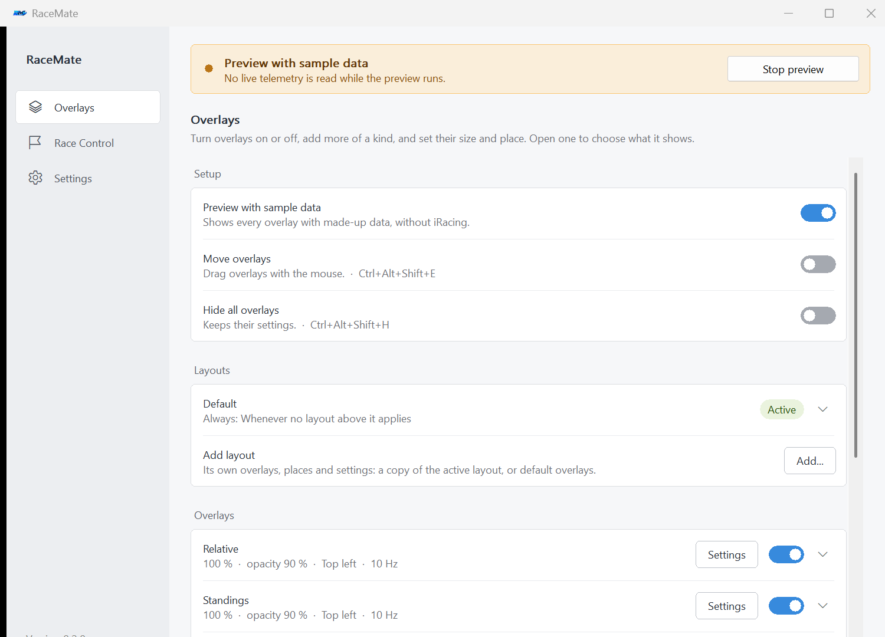

# Getting started

[Documentation](README.md) · Next: [Layouts and settings](layouts-and-settings.md)

## Requirements

| Requirement | Details |
| --- | --- |
| Operating system | Windows 10 or Windows 11 |
| Simulator | iRacing running on the same Windows machine for live telemetry |
| Display mode | Borderless windowed mode so Windows overlays can appear above the simulator |
| Runtime | A standalone native executable with the C++ runtime linked statically; no browser engine |
| Network | Used for update checks/downloads and uncached official Track Map assets |

You can configure and preview RaceMate without an active iRacing session. Circle and Line maps do not need a map download.

## Download and launch

1. Open the [GitHub releases page](https://github.com/gaggi/RaceMate/releases).
2. Choose the Windows **x64** executable for a 64-bit installation, or the **x86** asset if you need the 32-bit build. A ZIP is also provided for each architecture.
3. Place the executable in a folder you can write to, such as a dedicated RaceMate folder under your user account. Extract the ZIP first if you chose it.
4. Launch RaceMate. There is no installer wizard.

Release assets use names such as `RaceMate-v0.2.2-windows-x64.exe`. Locally built packages omit the `v`, for example `dist/x64/RaceMate-0.2.2-windows-x64.exe`.

Keep the executable in a stable location if you enable **Start with Windows**. In-app updates need permission to replace that file; a user-writable folder avoids a manual replacement step.

## First setup with Preview



*The main window contains the Overlays, Race Control and Settings pages. This capture uses sample data.*

1. Click **Preview** in the status banner or on the **Overlays** page. RaceMate displays sample telemetry.
2. Enable the overlay types you want to use. **Track Map** is disabled by default.
3. Turn on **Move overlays**. Drag the overlays into position; a dashed yellow border identifies Move mode.
4. Expand an overlay's row to adjust **Size**, **Opacity**, **Fixed corner** and **Updates**.
5. Click **Settings** on that row to choose its columns, modules, header and footer. A red border identifies the overlay whose page is open.
6. Click **Done**, or toggle Move mode off, when placement is complete.
7. Stop **Preview** before using live telemetry.

Outside Move mode, the overlays pass mouse clicks through and do not take focus. You do not need to save: changes are persisted immediately.

The preview of the official Map layout uses Lime Rock GP. Its first use needs the official assets or a valid cache; the rest of Preview can be used without those assets.

## Connect to iRacing

1. Run iRacing in borderless windowed mode.
2. Join a session. RaceMate connects automatically; no manual server address or account login is required.
3. Confirm that the status banner shows the track and session instead of Preview or the disconnected state.
4. Drive complete laps to let fuel consumption and pace history accumulate.

Most overlays remain available while spotting, watching replays or pausing playback. The reference car follows the camera when you are not driving. Fuel and weather history apply additional live-data checks, and **Pit Assist** is specifically for driving your own car.

When iRacing disconnects, the overlays hide unless Preview is enabled. If you need different arrangements for driving and spotting, create [automatic layouts](layouts-and-settings.md#automatic-layouts).

## Everyday controls

Global shortcuts move and hide the overlays, open the settings and step through Race Control events, also while iRacing has the focus; **Ctrl + Alt + Shift + E** toggles Move mode. See [keyboard shortcuts](layouts-and-settings.md#keyboard-shortcuts) for the full list and how to change them. In settings lists, **Space** toggles a row and **Enter** opens its settings or expands it.

## Closing, minimizing and quitting

Closing the main window normally keeps RaceMate running in the Windows notification area. Open it again from the tray icon or the settings shortcut. The tray menu also offers Preview, Move mode, visibility, Race Control and layout selection.

Choose **Exit** in the tray menu to quit completely. If Windows could not create a tray icon, closing the main window exits instead, and minimizing remains accessible.

## Updating and keeping your setup

Under **Settings → Updates**, use **Check now**, then **Install update** when a compatible release is available. RaceMate downloads the executable, replaces it and restarts. **Check for updates on startup** only updates the interface; installation requires your action.

Your preferences are stored separately from the executable:

```text
%LOCALAPPDATA%\RaceMate\settings.ini
```

For backup, migration and removal, see [Layouts and settings](layouts-and-settings.md#settings-backup-and-reset). If something is missing on screen, start with [Troubleshooting](troubleshooting.md).
