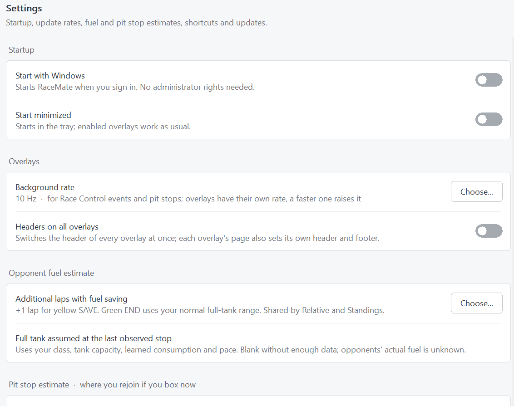

# Layouts and settings

[Documentation](README.md) · [Overlay reference](overlays.md)

## Position and appearance

Open **Overlays** and expand the row for an overlay. Its placement settings belong to that overlay in the active layout.

| Setting | Available choices | Effect |
| --- | --- | --- |
| Size | 50–150%, in 10% steps | Scales the overlay |
| Opacity | 40–100%, in 10% steps | Controls the overlay's opacity |
| Fixed corner | Top left, top right, bottom left, bottom right | Keeps that corner in place when content changes size |
| Updates | 1, 2, 5, 10, 15 or 20 Hz | Controls that overlay's refresh rate |

The fixed corner is useful for standings near the right edge or a panel above the taskbar: adding rows, columns, a header or a footer grows the panel away from that corner. Changing the corner does not itself jump the overlay to a screen corner.

Choose **Settings** in the row for content options. **Rounded corners** is a separate setting on that page; square corners are the default. **Reset positions** returns overlays to their default places on the main monitor.

## Automatic layouts


*Layouts store complete overlay arrangements; the list order sets automatic selection priority.*

A layout is a complete set of overlays: which ones are on, where they sit, their size, opacity, refresh rate and all their content settings. With several layouts, RaceMate can switch automatically, for example a full set while driving and a small one while spectating. Editing an overlay always changes it in the active layout only.

### Creating a layout

1. Select **Add layout**.
2. Choose a copy of the active layout or a set of default overlays.
3. Expand the new layout's row to edit **Name** and **Active when**.
4. Use the arrows to put more specific conditions above general ones.
5. Click **Use** to select a layout manually. The tray menu can also select layouts.

| Active when | Applies |
| --- | --- |
| In car | While you drive your car |
| Out of car | While you spot other cars or watch a replay |
| Garage | While the garage screen is open |
| Always | In every situation |

### How RaceMate chooses

Each time the situation changes and stays that way for one second, RaceMate goes through the list **from top to bottom** and activates the **first layout whose condition applies**. Layouts further down are only considered when none above them applies.

If **no layout applies**, all overlays are hidden until the situation changes to one that has a layout. The Overlays page then notes "None applies now: overlays hidden" on the layout that was last active. Some examples:

| Your layouts (top to bottom) | Driving | Spotting or replay | Garage |
| --- | --- | --- | --- |
| Only one layout, **Always** | shown | shown | shown |
| Only one layout, **In car** | shown | hidden | hidden |
| **Garage**, **In car**, **Always** | In car layout | Always layout | Garage layout |
| **In car**, **Out of car** | In car layout | Out of car layout | hidden |

So if overlays should appear in every situation, put an **Always** layout at the end of the list: it catches everything the layouts above it do not cover.

**Use**, or a layout picked in the tray menu, shows that layout right away, even when its condition does not apply. It stays until the situation changes next; then the automatic choice takes over again. Changing a condition or the order of the list applies at once. In **Preview** and while **Move overlays** is on, the active layout is always shown, so it can be arranged at any time.

The original **Default** layout keeps the settings from versions before layouts were introduced and cannot be removed. Added layouts can be removed with their bin button, together with their overlay settings.

## Multiple instances

**Add overlay** creates another **Relative**, **Standings**, **Fuel Calculator**, **Weather** or **Track Map**. Each has independent settings and placement, and a numbered name such as **Weather 2**. Pit Assist, Side Warning, Radar and Traffic are not offered as additional instances.

Useful arrangements include a second Weather overlay showing only the wind rose, a compact Relative beside a fuller Standings table, or an official Map alongside a wide Line map.

The bin button removes an added instance and its settings after confirmation. For original instances, use the visibility switch.

## Headers and footers

Every overlay supports a header and footer with up to **four metrics each**. The first slot is left aligned; the remaining slots are right aligned. Choose **None** for unused slots. All overlays offer the same metric list.

Footers are off by default. Pit Assist also starts without a header. **Settings → Headers on all overlays** switches headers globally; each overlay page also has its own header controls. A transparent Track Map hides its frame, captions, header and footer while retaining their settings.

See the [metric reference](overlays.md#header-and-footer-metrics) for which values describe the camera car, your own car or the overall leader.

## Global settings



*This sample configuration shows a +1-lap SAVE allowance. The factory default is +3 laps.*

| Setting | Behavior |
| --- | --- |
| Start with Windows | Adds RaceMate to the current user's Windows Run key; administrator rights are not needed |
| Start minimized | Starts in the tray when the tray icon is available |
| Headers on all overlays | Changes header visibility across overlays |
| Additional laps with fuel saving | 0–10, default +3; shared opponent SAVE allowance |
| Pit lane loss | Learned or manually fixed per track |
| Service times | Four-tire time and refuel rate per car and rule set |
| Check for updates on startup | Checks GitHub and reports availability in the interface |

RaceMate reads every frame iRacing publishes, 60 a second, so event recording, pit histories, consumption learning and finish forecasts see every frame. Each overlay is drawn only at its own rate, always on whole iRacing frames: 15 Hz is exactly every fourth frame, 66.7 ms apart. Rates of 1, 2, 5, 10, 15 and 20 Hz all divide 60, so every overlay refreshes at even intervals.

## Keyboard shortcuts

| Default | Action |
| --- | --- |
| Ctrl + Alt + Shift + E | Move overlays |
| Ctrl + Alt + Shift + H | Hide/show overlays |
| Ctrl + Alt + Shift + S | Open settings |
| Ctrl + Alt + Shift + Left | Previous Race Control event |
| Ctrl + Alt + Shift + Right | Next Race Control event |

To change a shortcut, click its button and press a combination containing **Ctrl or Alt**. **Esc** cancels; **Backspace** disables it. The reset arrow restores a changed shortcut's default. A conflict appears as **In use**, and the main banner identifies unavailable shortcuts.

These shortcuts work while another application has focus. Race Control's own **F**, **Enter** and divider keys are local to that window; see [Race Control](race-control.md).

## Settings backup and reset

RaceMate writes settings as you change them and remembers the main window's size and position. Its normal configuration is:

```text
%LOCALAPPDATA%\RaceMate\settings.ini
```

To back up, quit through the tray menu and copy `settings.ini` somewhere safe. To restore or migrate, quit RaceMate, put the saved file in the same local-app-data path on the target machine, then launch it. Overlay coordinates may need adjustment on another monitor arrangement; use **Reset positions** if necessary.

To reset all preferences, quit and **rename** `settings.ini` to a backup name. RaceMate creates a fresh configuration on its next launch. The official map cache is separate, under `trackmaps/v1`, so resetting preferences does not remove downloaded maps.

The INI is an implementation format. Prefer the interface for edits; added overlays and layouts use separate numbered sections. GUI diagnostics and benchmarks use `build/qa/settings.ini` instead of personal settings.

## Removing RaceMate

Turn off **Start with Windows** before deleting or moving the executable, then quit using **Exit**. Delete the executable or extracted folder. If you also want to remove preferences, learned pit settings and cached maps, remove `%LOCALAPPDATA%\RaceMate` after making any backup you need.

The startup entry is the `RaceMate` value under `HKEY_CURRENT_USER\Software\Microsoft\Windows\CurrentVersion\Run`. The application manages it through **Start with Windows**.
