# Overlay reference

[Documentation](README.md) · [Layouts and settings](layouts-and-settings.md) · [Fuel and pit strategy](fuel-and-pit-strategy.md)

## Overview

| Overlay | Purpose | Default refresh rate |
| --- | --- | --- |
| [Relative](#relative) | Nearby cars around the reference car | 10 Hz |
| [Standings](#standings) | Class or overall race order and lap times | 1 Hz |
| [Fuel Calculator](#fuel-calculator) | Consumption, range, refueling and pit windows | 1 Hz |
| [Pit Assist](#pit-assist) | Limiter state, pit lane progress and setup adjustments in the pit lane | 10 Hz |
| [Weather](#weather) | Current conditions, history and wind | 1 Hz |
| [Track Map](track-map.md) | Car locations on a Map, Circle or Line | 20 Hz |
| [Side Warning](#side-warning) | Bars at the screen edges while a car is beside you | 20 Hz |
| [Radar](#radar) | The cars around yours from above, lanes beside you estimated | 20 Hz |
| [Traffic](#traffic) | Faster cars close behind you, with their gap | 10 Hz |
| [Adjustments](#adjustments) | An in-car adjustment you make, big for a moment | 20 Hz |

Also on this page: [Position in the Relative](#position-in-the-relative) · [Table columns](#table-columns) · [Status badges](#status-badges) · [Header and footer metrics](#header-and-footer-metrics)

Choose an overlay's **Settings** button on the Overlays page to customize it. Appearance, placement and rates are explained in [Layouts and settings](layouts-and-settings.md).

## Relative

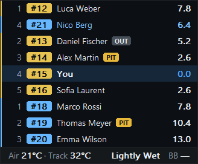

The Relative lists the cars **physically closest to you on track**, whatever their race position: cars just ahead of you on the road above your row, cars just behind below it. While you drive, the reference car is your own; while you watch, it is the car the camera follows. Your row always stays in the middle, even when one side has fewer cars.

The **gap** is an estimated driving time: how long the car behind needs to get to where the car ahead is **now**. For cars ahead of you that is your time, for cars behind you theirs. It is not a catch-up time: the car ahead keeps driving meanwhile. Nor is it a promise of room to rejoin.

- **How it is worked out.** RaceMate notes when every car passes points about every 10 m of the lap and keeps each car's last clean lap of them. Each pair is timed on the lap of the car that has to cover the distance. So a faster class behind shows when it would be where you are, a car beside you reads 0.0 in any class, and a car ahead that stopped or crawls comes closer as the distance to it shrinks.
- **Clean laps.** Watched from line to line, on track, out of the pits, without a full-course caution, without standing still, and not more than a quarter slower than the car's previous clean lap. A lap with a spin and a stop, or one crawled back with damage, never sets the pace; a little slower for tyres still does, and a second far slower lap as quick as the first (rain) becomes the new pace. The first racing lap after a rolling start counts; after a standing start it does not, as it begins by getting up to speed from the grid (nor does any lap begun within 30 s of standing still). Another car on the same entry starts afresh; a driver swap in the pits keeps the car's lap.
- **Current pace.** The lap gives the shape of the track (where it is slow, where fast); how the car drives now gives the level. Its actual time over its last 30 s of driving, divided by the time the lap takes for exactly those stretches, scales the result: rain, worn tyres or a slower driver on a class lap show within half a minute, not after a new clean lap. Standing still, the pits and telemetry gaps end that window; slow driving does not. The ratio always belongs to the lap it is measured against, so a new reference never applies it twice.
- **Stored laps.** The fastest clean lap of each class is kept between sessions, per layout, beside the settings (`pace\v1`), and rewritten only when a faster one is driven. In a new session it is the start reference until the session has laps of its own; the current pace scales it. A file for another track length, layout or point spacing is not used.
- **Before a car has its own clean lap**, the fastest clean lap of its class is used, then a stored one. **Before any clean lap at all**, in the first lap, the gap is measured: how long ago the car ahead was where the car behind is now. Where the car ahead crawled over that stretch (pit lane, a stop), that only says how slow it was, so it is capped a little above iRacing's own time estimate for one class (`CarIdxEstTime`), or more loosely above the distance along the lap for other classes. It is a cap rather than a switch, so the value never jumps. Until a gap has been watched for its length, the estimate is shown.
- **Order.** The rows, and whether a car is ahead or behind, always come from positions on track. The seconds behind you therefore need not grow row by row: a faster car further back can be there sooner.

### Relative settings

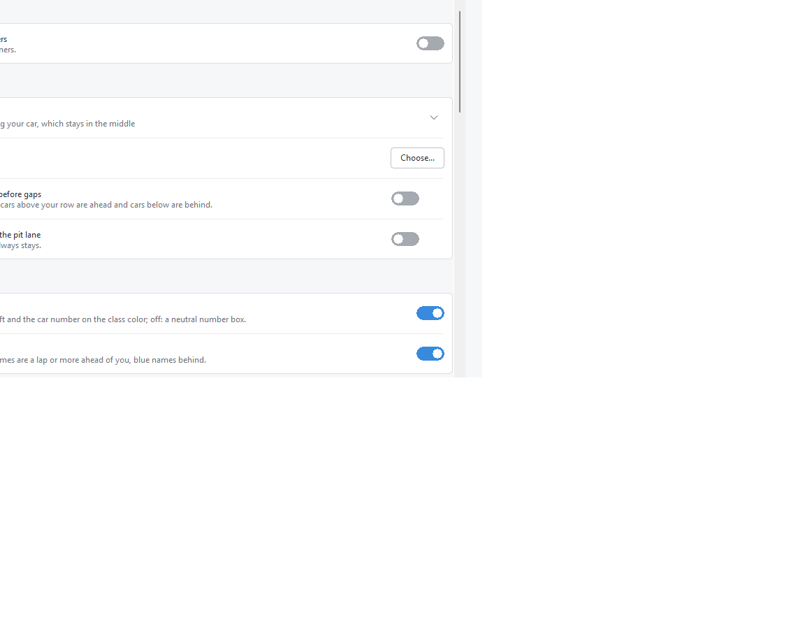

*The Relative page starts with its layout, then row and gap options. Scroll down for the columns, their order and their expanded options. Every Relative instance has its own settings.*

| Setting | What it does |
| --- | --- |
| Rows | How many rows the table shows, your own included: an odd number from 1 to 127. The default 7 shows three cars ahead, your car and three behind. Even numbers are rounded up. |
| Gap decimals | Decimal places of the gap, 0 to 3; default 1 (`1.4`). |
| Show + and − before gaps | Off by default, because the row order already tells: rows above you are ahead, rows below are behind. |
| Hide drivers in the pit lane | Leaves out cars in the pit lane; your own row always stays. |
| Class colors | Colors the stripe on the left and the car number box in each car's class color. Off: a neutral number box. |
| Lap colors | In races, names in red are at least a lap ahead of you, names in blue at least a lap behind. |

### Position in the Relative

The **P** column shows each car's race position. In a multiclass race there are two ways to count it. Choose one by expanding the **Position** row in the column list (arrow on the right):

| Choice | Meaning | Example |
| --- | --- | --- |
| In class (default) | Place within the car's own class | A GT3 car running 12th overall but 3rd among the GT3 cars shows **3** |
| Overall | Place in the whole field, across all classes | The same car shows **12** |

In a race with only one class, both give the same number. The Standings have no such choice: their position always follows their **Classes** view (see below).

## Standings


The Standings show the race order. In races, cars are ranked by their progress; in practice and qualifying by their best lap. Drivers without a valid lap time come last, ordered by car number or, if you choose, by iRating. Best and last laps combine live telemetry with the session results, so laps set before RaceMate was started still appear.

### Standings settings

| Setting | What it does |
| --- | --- |
| Rows in your class | **Leaders**, **Ahead** and **Behind**, 0 to 128 each: how many cars from the top of your class, and how many directly ahead of and behind the reference car, are listed. In the combined view the same numbers apply to the whole field. A dotted line marks where positions are skipped, so a short table still shows the leaders and your surroundings. |
| Rows in other classes | With separate classes: how many cars every other class shows from its leader, at least; default 3. With 0 a class shows only its header, so you still see how many cars it has. |
| Classes | **Separate classes**: one section per class with its own leader, positions counted within the class, and a header with the number of cars and the class strength of field (**SOF**). **Combined overall standings**: one list for the whole field with overall positions. |
| Only my class | Shows only the class of your car, or of the car you watch. |
| Live positions and gaps | Updates positions, gaps and intervals continuously from track position, with measured gaps: how long ago the car ahead was where the car behind is now, as on Formula 1 timing screens; a lapped car adds whole laps at the leader's pace. Off: they change only when cars cross the start/finish line, as iRacing reports them. |
| Show + before gaps and intervals | Off by default; both always count behind the leader or the car ahead. |
| Drivers without a lap time | Ordered by car number (default) or by iRating, highest first. |
| Class header | With separate classes, each class starts with a band in its darkened color, the class name on the full color. Expand to choose the values beside it: **Cars**, **SOF**, **Average iRating** (on by default) and **Class best lap** (off). SOF is iRacing's weighted strength of field, which counts strong drivers more; the average is the plain mean of the class's iRatings. |
| Class colors | As in the Relative. |
| Session progress | A thin bar under the header that fills by elapsed time or completed laps. |
| Pit exit row | Off by default. In races, a faded copy of your row where you would rejoin if you pitted now. |

The fastest lap in each class is shown in purple. A last lap that equals that car's own best is green.

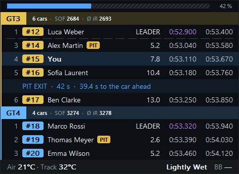

Expand **Pit exit row** to choose how many cars ahead of and behind the rejoin position stay visible, even cars the normal row selection would leave out; the default is two each. How the rejoin position is estimated, and its limits, is explained under [Pit exit estimate](fuel-and-pit-strategy.md#pit-exit-estimate).

## Table columns

Relative and Standings use the same set of columns. Each overlay has its own choice of columns, order and formats. In the column list, columns marked **Always** cannot be hidden; all others have a switch. Drag a column up or down by the six dots at its left to change the order; a hidden column keeps its place. **Copy to another table** gives another Relative or Standings the same columns in the same order with their options; columns only that table has keep their setting and place. Between a Relative and a Standings, the Relative keeps its own Best and Last switches and Position option, and the Standings their Laps and Gained switches; between two of a kind these go too. Rows, gap decimals and other settings outside the columns stay. Columns with an arrow on the right have further options when expanded.

| Column (heading) | What it shows | Options when expanded |
| --- | --- | --- |
| Position (P) | Race position. | Relative: **In class** (default) or **Overall**, see [Position in the Relative](#position-in-the-relative). Standings: follows the **Classes** view. |
| Car number (#) | Car number in a box in the class color. | – |
| Driver | Driver name, with the status badge after it, see [Status badges](#status-badges). The badge belongs to the name and moves with it. | Name format: **First name Last name**, **F. Last name** or **F Last name**. **Status badge after the name** on or off, and which flags it shows: **Black flag**, **Slowdown**, **Required repairs**. |
| Gap (GAP) | Relative: time to the reference car. Standings: time behind the class leader, or laps (`1 L`) when lapped. | – |
| Interval (INT) | Time to the car directly ahead, also when that car is not listed. Standings only. | – |
| Best lap / Last lap | Fastest lap of this session and the most recent lap. | – |
| License | License class and safety rating, for example `A 3.45`. | Short view: safety rating only (`3,45`). |
| iRating | The driver's iRating. | Short view in thousands (`2,4K`). |
| Safety and iRating (RATING) | iRating in a badge colored like the license class. | Short view in thousands. |
| iRating change (iR ±) | Estimated iRating gain or loss if the race ended in the current order. | – |
| Car brand (CAR) | Manufacturer logo, name, or both; the first letter where no logo exists. | **Show logo**, **Show name**. |
| Tires | D for dry, W for wet, or the compound initial such as S/M/H for cars with several compounds. | – |
| Laps since stop (STINT) | Laps since the last stop or the start, for example `L12`; `L-` until RaceMate has seen one. | – |
| Pit stops (STOPS) | Stops observed in this race; `?` when RaceMate joined late and may have missed some. | – |
| Last pit lap (PIT LAP) | Lap of the last observed pit entry. | – |
| Pit lane time (PIT TIME) | Time from pit entry to pit exit. | – |
| Pit stop time (PIT STOP) | Estimated time standing in the pit stall, marked `≈`. | – |
| Sector times (S1, S2 … or S1.1, S1.2 …) | One column per sector with its observed time, colored green (personal best), purple (class best this session) or yellow (slower). A new S1 clears the previous lap's later sectors; see [sector timing](sector-timing.md). | **Sector detail**: SDK sectors or 3 mini-sectors per sector. |
| Fuel to finish (FUEL) | For cars of your class: green **END** if they can reach the finish at normal consumption, yellow **SAVE** if only with fuel saving; see the [strategy guide](fuel-and-pit-strategy.md#opponent-fuel-end-and-save). | – |
| Completed laps (LAPS) | Laps completed instead of the current lap number. Standings only. | – |
| Positions gained (GAIN) | ▲/▼ places won or lost against the starting grid. Standings only. | – |

### Status badges

Only one driver status is displayed, with this priority:

```text
PIT > TOW > BLACK/DQ > REPAIR > SLOW > OUT
```

**OUT** lasts from an observed pit exit until the next line crossing. Towing is taken from the SDK for your car and inferred for others from a direct return to the stall. The badge and its black flag, slowdown and repair indicators are switched in the expanded **Driver** column row. An inferred status is limited by what RaceMate has actually observed.

## Fuel Calculator

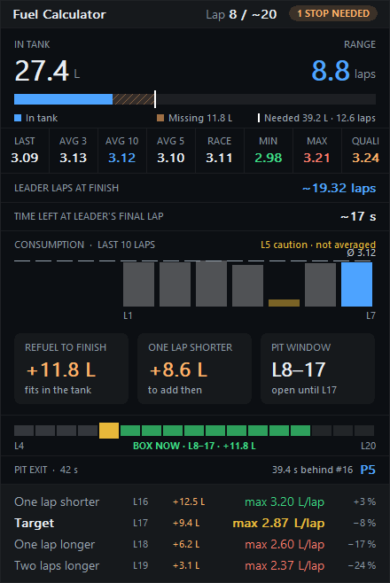

The Fuel Calculator groups information into switchable, reorderable modules: drag a module up or down by the six dots at its left in the settings list. Choose **Panel** for stacked modules or **Strip** for a horizontal arrangement. Options unsupported by the strip are labeled **Panel only** in settings.

| Module | Shows |
| --- | --- |
| Tank | Current fuel, range in laps and a finish requirement/spare marker |
| Consumption | Last lap; averages of 3, 10 and 5 laps; race average; minimum and maximum; the qualifying maximum |
| Last 10 laps | Whole-lap consumption history against the 10-lap average |
| Refuel to finish | Additional fuel required without a safety margin, or fuel left at the finish |
| One lap shorter | The same if the race runs a lap shorter than forecast, as when the leader still has to stop |
| Pit window | Earliest and latest stop lap |
| Pit window timeline | Full-tank stint blocks, window in green and current lap in yellow |
| Pit exit | Predicted class position, car ahead and pit loss; off by default |
| Target and adjacent rows | Maximum per-lap burn for the normal target and one fewer, one extra or two extra laps, with the fuel to add when you stop on that lap; outside races the laps the fuel lasts at the average, and the most per lap for one fewer or more |
| Leader forecasts | Fractional leader distance and projected final-lap start clock; off by default |

Expand **Consumption** to select its individual figures, **Last 10 laps** to enable yellow caution markers, and **Target** to switch the fuel to add on the target rows. Caution laps still do not contribute to the consumption average. Adjacent card modules (refuel, one lap shorter, pit window) share a row, up to three, and adjacent target modules share a band.

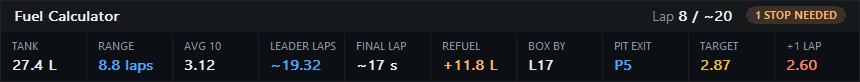

Fuel learning, finish projections, surplus colors and pit assumptions are described in [Fuel and pit strategy](fuel-and-pit-strategy.md).

## Pit Assist

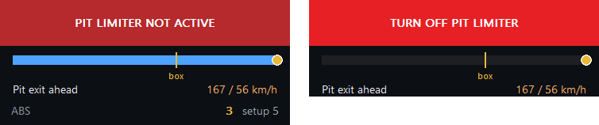

*Left: in the pit lane with the limiter off and ABS changed since the setup. Right: past pit exit with the limiter still on.*

Pit Assist (formerly Pit Limiter) appears on pit approach and in the pit lane **while driving your own car**. It is not a general spectator overlay. Settings saved under the old name keep loading.

| Appearance | Meaning |
| --- | --- |
| Green | Limiter active |
| Red | Limiter not active |
| Gray | The car's limiter status is unavailable |
| Flashing red after pit exit | Limiter still active; **TURN OFF PIT LIMITER** |

After pit exit it hides when the limiter is off. If the limiter remains on, the warning continues until you disable it.

### Pit lane progress

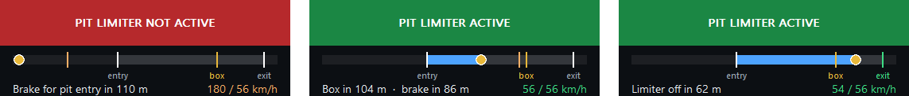

*Left to right: braking for the pit entry, in the lane towards your box, past the box towards the exit.*

**Pit lane progress** is enabled by default. A strip under the limiter bar shows the pit lane from before the entry to past the exit: your car, **your box** in yellow, the entry and exit lines, and an orange **brake point**. The line below says what comes next, with your speed against the pit speed limit. The strip keeps its start from the moment it appears, so it doesn't shift when you reach the entry.

**Countdown** counts in metres along the lap by default; **Seconds** counts in tenths of a second at your current speed, and in metres again when you are nearly stopped.

| Phase | Text |
| --- | --- |
| Approaching above the limit | **Brake for pit entry in 110 m** (or **2.2 s**), then **BRAKE NOW**; speed in orange while above the limit |
| Approaching at or below the limit | **Pit entry in … m** |
| In the lane before your box | **Box in 104 m · brake in 86 m** |
| Stopped in your box | **In your box** |
| Towards the exit | **Limiter off in 62 m**; the exit line turns green |

Your box position and the speed limit come from iRacing's session information. The entry and exit lines are learned from any car that drives into or out of the pit lane, then kept per track; until then the strip shows your box and its brake point only. Distances are along the lap, so the box is placed by its distance from start/finish rather than its side of the lane.

The entry brake point uses your car's deceleration, measured from your own braking zones with the pedal well down and kept per car, with a 5 % margin. Until it is learned, RaceMate assumes 10 m/s². The countdown shows the brake point coming, so no reaction time is added. Braking into the box assumes 7 m/s². Neither is learned in Preview, where a car drives through the pit lane at the limit, stops in its box and leaves again.

**Setup changes** is enabled by default. In the pit lane it lists supported adjustments that differ from the loaded setup, showing current and setup values: brake bias, ABS, traction control, throttle map, fuel mixture and engine braking where available. If a dial already differs when you enter the car, RaceMate treats it as not comparable for that car and leaves it out.

## Side Warning


Two narrow bars, by default at the left and right edge of the screen, light up while a car is beside you: the left bar for a car on your left, the right bar for one on your right. They show **only while you drive your own car**, as iRacing's spotter reports it (`CarLeftRight`), and stay lit 300 ms after the side clears so they don't flicker. The Side Warning is off by default; switch it on under **Overlays**.

| Appearance | Meaning |
| --- | --- |
| Red bar | A car beside you on that side |
| Two red stripes | Two cars on that side |
| Amber block | Where the car beside you is along your car: higher when it is ahead, lower when behind. The bar spans 7 m either way |

The spotter tells the side, but not which car is there. RaceMate takes the nearest car within 10 m along the lap as the one beside you. With cars on both sides their lap distance cannot tell which is where, so neither bar shows a block then. **Where the car beside you is** switches the block off.

The bars stay centred on their monitor. **Distance apart** sets how far apart their outer edges are, as a share of the screen width: 100 % puts them at its edges, down to 20 % for bars close beside the middle of the screen. Drag either bar up or down, or onto another monitor: they go over as soon as the mouse is on it, and the other bar follows at the same height. Size, opacity and rounded corners apply to both, and both get the same frame while overlays are moved or the page is open. Both bars show while overlays are moved, in grey when nobody is beside you. The Side Warning has no header or footer, and only one instance.

## Radar

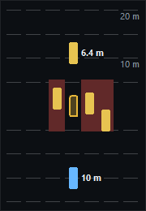

The cars around yours from above: your car in the middle, outlined in yellow, the others in their class colour, how far ahead or behind they are up and down the radar. Dashed guides mark every quarter of the range, labelled at half and full range. Where the spotter reports cars beside you, the lanes there are shaded red. The Radar is off by default; switch it on under **Overlays**.

| Setting | Choices |
| --- | --- |
| Background and frame | On: a panel like the other overlays. Off: transparent, only cars, guides and distances over the game |
| Range | 10, 20 (default), 30 or 40 m ahead and behind |
| When it shows | **With cars near** (default): while you drive and a car is within range, until 2 s after the last one left it. **Always while you drive** |
| Distances | The gap bumper to bumper to the nearest car ahead and behind, in any lane, beside it on the outer side; with one decimal under 10 m |

It shows only while you drive your own car, not while spotting or in replays; both settings for when it shows apply to that. While overlays are moved or previewed it always shows.

**Lanes are estimated.** iRacing reports where every car is along the lap, but not across the track. Distances ahead and behind come from each car's share of the lap (`CarIdxLapDistPct`) times the track length, and the bumper-to-bumper gaps take every car as 4.6 m long: estimates along the racing line, not measured spacing or real car lengths. Lanes come from the spotter (`CarLeftRight`):

- The cars beside you, as many as it reports, take the side it reports: a car within 5.5 m that had that side keeps it, otherwise the nearest within 8 m. Two cars on one side are in two lanes, since you are then at the edge of three wide.
- A car that clearly overlaps yours (within 3.5 m) is beside you even when the spotter doesn't report it, as when you stand beside the track or a car has only just come alongside: on the one side the spotter reports, else the side it was last on, else the free side.
- A car keeps its lane for 3 s after it was last beside you, and as long as it is within 8 m of you or beside another car. Only then does it count as in your lane, so cars don't jump into your lane while overtaking or being overtaken.
- Two cars in your lane, ahead or behind, that overlap each other must be side by side: they are drawn half a lane to either side, and stay so until they no longer overlap at all. Each keeps the side it was last on, beside you or beside another car; otherwise the one ahead goes left. A third car in such a row goes beside its neighbour.

A car that changes lane glides across in about a quarter of a second. Cars in the pit lane appear only while you are in it too. Like the Side Warning, the Radar has no header or footer and only one instance.

## Traffic

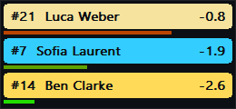

After irdashies' *faster cars from behind*: the cars of faster classes close behind you, one box each, closest first. A box shows the car's number and driver in its class colour and its gap, such as **-1.4**. Under it a bar fills and turns from green to red as the car closes in; within 1.5 s the box pulses. Traffic is off by default; switch it on under **Overlays**.

| Setting | Choices |
| --- | --- |
| Background and frame | Off (default): transparent, only the boxes over the game. On: a panel like the other overlays |
| Cars | 1 (default), 2 or 3 boxes, the closest ones |
| Within … s behind | 1, 2, 3 (default) or 5 s: it shows while a car is that close behind you |
| Faster classes only | On (default): only classes whose estimated lap (`CarClassEstLapTime`) is at least 2 % quicker than yours. Off: every car behind you |

A car counts as behind by its position on track. The gap is the Relative's: the time that car needs to reach you, at its own pace on its last clean lap, so a faster class shows when it is there. Before it or its class has a clean lap, the Relative's first-lap gap. Traffic takes no car length off. Cars in the pits are left out, and nothing shows while you are in them.

It shows while you drive your own car and a car is within the gap, and half a second after, so it doesn't flicker at the edge. While overlays are moved or previewed it always shows. Like the Side Warning and the Radar, Traffic has no header or footer and only one instance.

## Adjustments

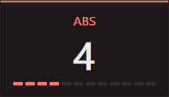

When you change an in-car adjustment while you drive, such as ABS, traction control, brake bias or an anti-roll bar, Adjustments shows it big for a moment: the dial's name in its group's color and its new value in the middle. Under the value, the dial's steps light up to where it now stands, such as 4 of 12. Another change starts the time again; a change to another dial takes its place. Adjustments is off by default; switch it on under **Overlays**.

| Setting | Choices |
| --- | --- |
| Where it shows | Its own window (default), placed and sized like the other overlays and hidden until you change a dial. Or in place of the **Relative**, **Standings**, **Fuel Calculator** or **Weather**: every one of them that is shown shows it instead for that moment, at its own size, on the dial's color |
| For … s | 1, 2, 3 (default), 4 or 5 s after your last change |
| Sample | **Show** displays ABS 4 for that long, as a change would |
| Value before | Off (default). On: **was 3** under the value. It is the value before your first change, so two steps from 3 down to 1 read **1**, **was 3** |
| Time left | Off (default). On: a bar along the bottom edge runs down until it goes |
| Brakes, Traction, Chassis, Engine, Hybrid | Which dials it shows, all by default |

| Group | Color | Dials (iRacing's `dc` variables; each car has only some) |
| --- | --- | --- |
| Brakes | Red | Brake bias, ABS, peak brake bias |
| Traction | Yellow | TC, TC 2 to TC 4 |
| Chassis | Violet | ARB front and rear, weight jackers, differential entry, middle and exit |
| Engine | Teal | Throttle map, fuel mixture, engine braking, engine power, boost |
| Hybrid | Blue | MGU-K deploy mode and fixed deploy, regen gain |

iRacing reports a dial's value but not its lowest and highest step. RaceMate learns them per car as you drive and keeps them for its next session. The steps appear once three or more of them have been seen, so the first sessions in a new car may show the value without them. Brake bias shows no steps.

For the first 2 s after you get in, the dials settle to the setup and nothing shows. Nothing shows in replays or while you watch another car. Like Traffic, Adjustments has no header or footer and only one instance.

## Weather

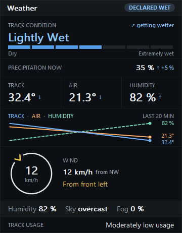

Weather shows current observations and locally collected history. Each module can be switched and reordered.

| Module | Details |
| --- | --- |
| Track condition | Dry, Mostly Dry, Very Lightly Wet, Lightly Wet, Moderately Wet, Very Wet, Extremely Wet |
| Precipitation | Current reported rain at start/finish |
| Temperatures | Track and air temperature; expand to add humidity as a third value |
| Temperature history | Track temperature over up to the last 20 minutes, with air temperature as a second line; expand to switch the air line and add humidity as a dashed line. The panel reports how much history is available |
| Wind | Speed, compass direction, a wind rose and relative direction when heading is available |
| Details | Humidity, sky and fog |
| Track usage | Track rubber/usage information |

RaceMate samples weather every 30 seconds. Trend arrows compare with ten minutes earlier once at least five minutes of history are available. Historical replay does not advance the live weather history. Precipitation is an observation; iRacing does not provide a weather forecast for RaceMate to show.

Wind can be relative to your car, or the car you watch live or in replay. iRacing reports the heading of the car you drive, and of the replayed car while it moves; for a car you watch live it reports none, so RaceMate takes its direction of travel from the official track map at its lap position, turned to north as described under [Track Map](track-map.md#north). Text such as **Crosswind from the left** describes the source relative to that heading. Without a heading, car-relative information is unavailable.

With a single line, the history shows its highest and lowest value on the right. With several lines, each line has its own scale, so track, air and humidity each show their own trend even though they lie far apart; the right side then shows each line's current value in its color. The legend in the title names the lines in the same colors.

Expand **Wind** to choose the wind rose, wind text or both. With only the wind rose enabled, the overlay shrinks to the ring; a second Weather instance is useful for this arrangement.

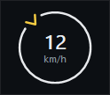

**Panel** stacks the modules. **Strip** puts track condition, rain, temperatures (with humidity, when chosen) and wind in one line; other modules remain labeled **Panel only**. The header can show **DECLARED WET** when rain tires are allowed.

## Header and footer metrics

Each header and footer offers the same list, with four slots. Use **None** to leave a slot unused. These are the available metrics grouped by purpose:

| Purpose | Choices |
| --- | --- |
| Identity | Overlay Name, Track, Track and layout, Session Type |
| Conditions | Track Temperature, Air Temperature, Temperatures, Track Wetness, Wind, Declared Wet |
| Clocks | Session Time Remaining, Session Time Elapsed, Local Time, Sim Time |
| Car/session context | Incidents, Class SOF, Position in Class, Current Lap |
| Reference-car forecasts | Current / Expected Final Lap, Estimated Laps Remaining |
| Overall-leader forecasts | Leader projected race distance, Time left at leader's final lap |
| Combined lap context | Current lap / Leader projected distance |
| Your-car values | Brake Bias (your car), Stops Needed (your car), Pit exit (your car), Fuel at finish (your car) |

Incidents include the race warning/disqualification limits when provided. The leader forecasts always describe the **overall leader**, even when you are watching another class. Fuel and pit metrics explicitly labeled **your car** continue to use player data.

For example, `Lap 8 / ~19.32` combines the reference car's current lap with the leader's fractional projection. It is distinct from the rounded finishing lap in **Current / Expected Final Lap**. A forecast is marked `~`; unavailable values show `—`.
