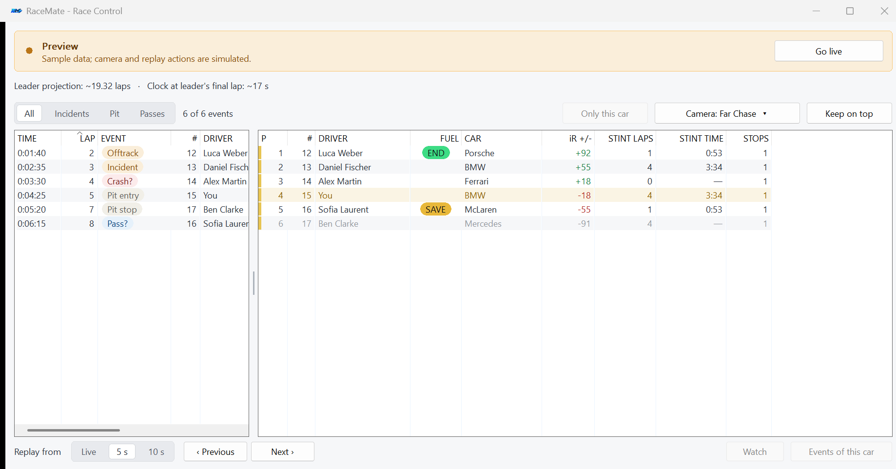

# Race Control

[Documentation](README.md) · [Fuel and pit strategy](fuel-and-pit-strategy.md)

Race Control is a separate resizable window with an event feed on the left and full standings on the right. Open it from the **Race Control** page or the tray menu. The global previous/next-event shortcuts also open it when necessary.

*Preview uses fictional events. Camera and replay actions are simulated while Preview is active.*

## Recorded events

RaceMate retains up to **2,000 events for the current session**. It records what it observes while running; it is not a complete retrospective event archive.

| Event | Evidence and interpretation |
| --- | --- |
| Offtrack | Observed transition off the track |
| Incident | Increased reported incident points, or a newly observed black/disqualification flag |
| Crash? | A new repair flag or sudden off-track speed loss suggesting a possible crash |
| Pit entry | Observed entry into the pit lane |
| Pit stop | A completed observed pit visit, including lane time and estimated stationary time where available |
| Pass? | An estimated same-class overtake from a sustained observed order change |

Crash and pass labels are estimates. A pit visit does not prove that fuel or tires were serviced. Events lost while RaceMate was not connected cannot be reconstructed from the feed.

During historical replay, car movement reflects recorded footage. RaceMate therefore avoids counting that movement as new live events. Incident-point changes from live session information can still be recorded, using live session time.

## Find the events you need

Use **All**, **Incidents**, **Pit** or **Passes** to filter by category. The car filter can be applied in two ways:

- Select an event, then choose **Only this car** above the event list.
- Select a driver in standings, then choose **Events of this car**, or press **F**.

The filter pill identifies the active car and can clear it. Previous/next navigation uses the events currently shown after filtering.

Click a table heading to sort. **Event lap** can be enabled in settings to show the recorded lap beside an event's time; it sorts numerically. Unknown values sort last for the optional numeric fields.

## Replay and camera workflow

Camera and replay controls operate **when you are out of the car**.

1. Set the desired camera group with the **Camera** button.
2. Under **Replay from**, choose **Live**, **5 s** or **10 s**. Five seconds is the default.
3. Double-click an event, or select it and press **Enter**.
4. Use **‹ Previous** and **Next ›** to review adjacent visible events.
5. Select **Go live** in the banner when you want to return to live action.

**Live** focuses the event's car in the live session. The other modes seek to the selected lead time before the event, then focus the car and play. On a standings driver, double-click or **Watch** replays the last 5/10 seconds of that car relative to the moment on screen.

A replay jump waits for iRacing to reach the requested time before switching camera and playing. If it cannot reach it within **12 seconds**, playback continues from the available position and the interface explains that the footage may be older than the replay buffer retains.

**Previous/Next always step in time order**, regardless of the current table sort. The global shortcuts are Ctrl + Alt + Shift + Left/Right by default and can be changed under Settings.

## Standings and optional information

Standings include class stripes, status pills and your incident count. Available statuses include Pit, Out, Tow, Repair, Black, DQ and Inactive.

Open the **Race Control** settings page, or right-click a table heading, to choose displayed fields. Its column switches are independent of overlay column switches.

| Group | Available fields |
| --- | --- |
| Identity/order | Position, car number, driver, class, completed laps, positions gained |
| Timing | Gap, interval, best lap, last lap |
| Status | Track/pit status, flags, incidents, tires |
| Driver information | License/safety rating, iRating, car brand, estimated iRating change |
| Pit/stint | Last pit lap, pit lane time, pit stop time, pit stops, laps since stop, stint time |
| Fuel | Opponent Fuel to finish with shared END/SAVE semantics |
| Event table | Timestamp, type, car, driver, details and optional event lap |

Fuel to finish, laps since stop, stint time, pit stops, iRating change and car brand were added as optional fields and start disabled. Stint time runs from an observed race start or pit exit and is unavailable in the pits, replay or after a telemetry gap. Missing values generally show a dash; missing opponent fuel is blank.

Under **Race information above the tables**, enable **Leader projected race distance** and/or **Time left at leader's final lap**. The extra information row takes space only when a value is enabled. These are the same [forecasts](fuel-and-pit-strategy.md#finish-forecasts) used by overlays and also work in Preview.

Optional fuel and iRating calculations share cached results with overlays and are requested only when displayed. Field choices, sorting and window preferences survive closing and reopening.

## Adjust the window

Drag the divider between event and standings tables to change their width ratio. The original split is **56% events / 44% standings**. Both tables retain a minimum width, and filters/replay controls remain accessible independently.

| Divider action | Result |
| --- | --- |
| Drag | Resize the two tables |
| Left / Right with divider focused | Adjust the split with the keyboard |
| Double-click | Restore the original split |
| Home with divider focused | Restore the original split |

The ratio is saved across restarts. **Keep on top** keeps Race Control above the simulator in borderless windowed mode. Exclusive fullscreen prevents normal Windows windows from appearing above the simulator.
