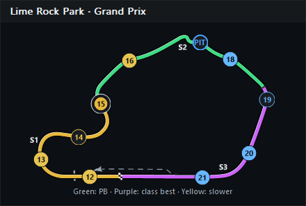
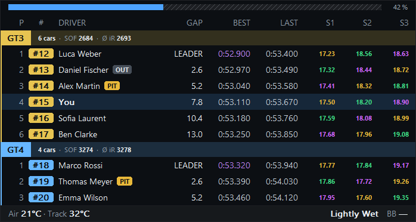
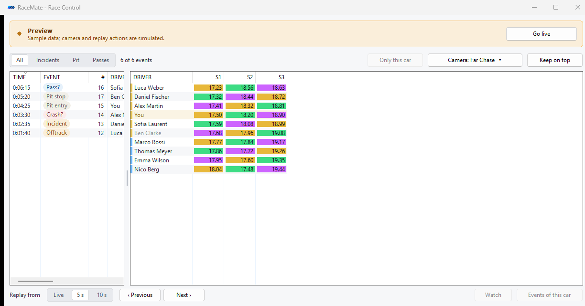

# Sector timing and mini-sectors

[Documentation](README.md) · [Track Map](track-map.md) · [Race Control](race-control.md)

RaceMate estimates split times from observed telemetry. These are local interpolated measurements, not official iRacing timing or a full official lap-validity check. Every view shares one timing model.

## Track Map

Enable **Track Map → Settings → Sectors and mini-sectors → Show sectors**. Only then do the sector options appear. **Sector detail** (per map) selects SDK sectors or **3 mini-sectors per sector**; the latter divides each official sector into three equal lap-distance intervals, not equal-time intervals or official mini-splits. Circle and Line support the same display.

The full width of the active circuit is coloured for your car, or the camera car while spectating live. **Split marks** (optional) are dark lines in the frame colour; official boundaries are thicker than mini boundaries. **Sector labels** (optional) S1, S2, S3 sit beside the middle of each sector, without background boxes: RaceMate tries spots along the sector, outside the circuit first, and takes the first one that touches no road (other parts of the circuit included) and no other label; with no free spot near a sector, that label is left out rather than drawn on the road. Label size and contrast follow the map's corner-label settings. Maps with more than 12 official sectors omit further sector labels to avoid clutter; all segments still receive colours and boundary marks.

The colours follow the [Formula 1 sector convention](https://www.formula1.com/en/latest/article/f1-glossary-p-t.GBhLQtpeu9b8LrK5VM0F1):

- **Purple:** this split equals the fastest time RaceMate has observed from any car of the same class in this session.
- **Green:** this split improved that driver's personal best, but is slower than the class record.
- **Yellow:** this split did not improve the driver's personal best, or it is not representative: it includes the pit lane, an off-track, an incident, a formation lap or a full-course caution. Such splits are shown but never become a record.
- **Grey:** no completed, usable split in the current lap yet.

The same rules apply independently to mini-sectors. Official-sector records use their own total times; they are not sums of independently chosen best minis. Purple takes precedence over green and is withdrawn if another car of that class subsequently sets a faster record. Each class has its own records, so every class can show purple in a multiclass race. They are not lifetime records: RaceMate does not save cross-session sector history.

Segments follow the same lap rule as the tables (below). The map has no opponent selector or last/best-lap selector. The panel caption shows the colour key; transparent mode shows only the map, marks and labels.

The official SVG projection retains its existing accuracy limits: lap-distance fractions are mapped to drawing arc length, which may not line up exactly with simulator distance. The colouring follows that same projection.

## Relative and Standings

In each overlay's **Settings → Columns**, enable **Sector times**. Expand it for **Sector detail**: **SDK sectors** (S1, S2, S3 …) or **3 mini-sectors per sector** (S1.1, S1.2, S1.3, S2.1 …). Each sector gets its own column with its own heading; the group is dragged among the other columns as one. Times are in seconds with the green/purple/yellow status; absent data is **—**.

Times follow the lap, as on Formula 1 and DTM timing screens:

1. Just after start/finish the row still shows S1, S2 and S3 of the lap just finished.
2. When the new S1 is completed, it appears and S2 and S3 of the previous lap are cleared.
3. S2 and then S3 appear as each is completed, and stay until the next S1.

Pit stops do not hide times: the in-lap's last sector and the out-lap's first sector include the pit lane and appear in yellow. Only a sector RaceMate did not watch from its start, for example after joining mid-sector, stays empty. The unfinished running time never replaces a completed value. Full sectors and mini-sectors follow this rule independently: the first mini of a new lap clears the previous lap's minis, the full sectors wait for the complete S1. Each overlay chooses its columns independently, including copied column settings. More official sectors make the group wider.

## Race Control

Switch on **Race Control settings → Standings columns → Sector times**; expand it for **Sector detail**: SDK sectors or mini-sectors. The standings get one column per sector (S1, S2 …) with the same lap rule and pace colours as Relative and Standings: a completed time sits on its colour, a sector not yet completed this lap is a grey dash. Each column sorts by its own header; cars without a time in it go last.

Turning **Sector times** off hides the columns. There is no reference-delta column or comparison lap basis.

## Definitions and observation limits

Boundaries come from `SplitTimeInfo / Sectors / SectorStartPct` in session YAML. Tracks may supply more than three sectors. Missing/malformed definitions produce no timing; RaceMate does not invent official thirds. The model supports up to 64 official sectors.

Crossing times are interpolated between successive session timestamps and car lap positions. Progress follows the lap-distance fraction through its wrap at the line instead of the lap counter, which iRacing may update a frame earlier or later; the counter only seeds the lap number after an interruption, which never decreases for a car. Individual splits become available as soon as their entire interval has been observed; a full lap is not required. Joining mid-sector cannot produce that partial sector's time.

Every observed split is shown. Pit lane, off-tracks (`CarIdxTrackSurface` other than on track), incidents, formation laps and full-course cautions or red flags only keep a split out of the records, per mini-sector: the next clean mini-sector counts again. Observation itself ends only with a tow, a jump, driving backwards or more than 1 s without a position; that sector then stays empty. iRacing briefly reports some cars as not in the world while they drive on; those frames are bridged and do not count against the split. Local yellows do not affect timing: they slow only the cars near them, and those sectors are simply slower. A later incident does not retroactively retract an earlier completed split, because incident counts arrive delayed through the session string and are reliable only for your own car. These records therefore describe the clean observation of each interval, not an official valid-lap judgement. Replay pauses learning and hides live timing values. Session/track/definition changes, clock rewinds and disconnection clear history. A driver/car identity change clears that driver's values; previously observed class records remain until the session resets.

Opponent updates, network smoothing and delayed/incomplete incident information limit precision. Times displayed to hundredths are estimates, not proof of official qualifying validity or accuracy to a hundredth.

## Resource use and validation

Timing runs on every telemetry frame while iRacing is connected (about 2 µs a frame for 60 cars), so records are complete when a sector view is opened mid-session. The model uses bounded storage for actual sector counts, with no timing-vector allocation per telemetry frame. It retains the current lap's mini samples, latest completed split values, independent personal split records and per-class session split records. Complete-lap comparison buffers and calculations are omitted.

Each map caches its base bitmap and a sparse mask of the actual road. Geometry-to-sector assignment runs only on layout, geometry, size or relevant style changes. Colour changes reuse that assignment. If the colours stay the same, the composed bitmap is reused. Changes to the reference car or session records trigger colour checks; ordinary slower splits by unrelated cars do not invalidate the map. Moving markers still follow the normal overlay refresh rate. The more expensive initial mask preparation is not part of the cached-refresh benchmark.

See [Development](development.md). `RaceMateTests --benchmark-sectors` measures frame construction plus timing for 60 and 128 cars. Tests cover early split publication, the lap rule (new S1 clears S2/S3, out laps starting at S2), late and early lap counters at the line, class records under a local yellow, personal/class colours, independent mini records, partial observations and invalidation. GUI diagnostics capture full/mini sectors in all three map layouts, transparent maps at different sizes/opacities, and one column per sector and mini-sector in all three tables. These checks do not replace a live iRacing drive.
