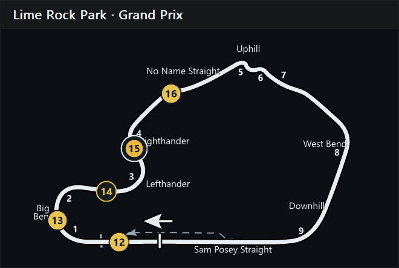
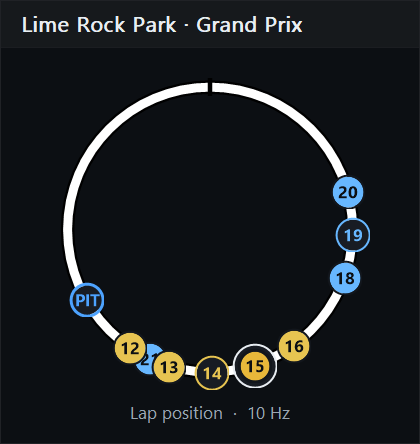
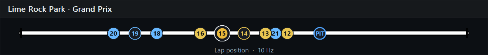
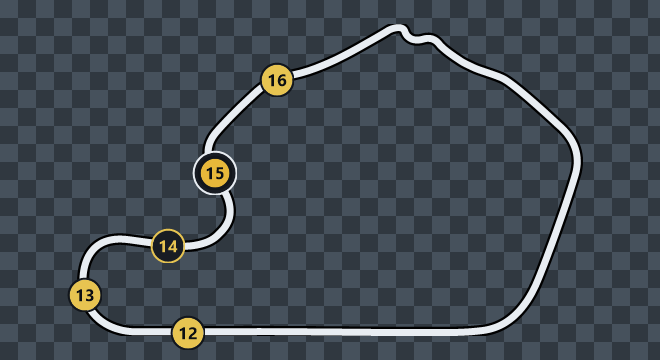

# Track Map

[Documentation](README.md) · [Overlay reference](overlays.md) · [Simulator validation](track-map-validation.md)

Track Map is experimental and starts disabled. Enable it on **Overlays**, then open its **Settings**. It can display the official track shape or a schematic layout based only on lap position.

## Choose a layout

| Layout | Display | Download required? |
| --- | --- | --- |
| Map | Official iRacing drawing for the exact track layout | Yes, on first use unless cached |
| Circle | Lap progress clockwise around a ring, with 0% at the top | No |
| Line | Lap progress from left to right on a bar | No |

Circle and Line work on every track without preparing SVG geometry. The Line layout suits wide 21:9 and 32:9 monitor arrangements. These are alternative displays, not fallback geometry substituted for an unsupported official Map.



*Map layout with optional official corner names and numbers enabled. Sample car positions are rendered by RaceMate.*





## Identity and downloads

The official Map uses iRacing's exact **TrackID**, checked against the internal **TrackName**. The built-in index in this version contains **424 layouts**. Unknown layouts stay empty rather than showing a similarly named track.

RaceMate downloads assets directly from iRacing's public asset server on a worker thread. A login is not required. The important layers are:

| Asset | Purpose |
| --- | --- |
| `active.svg` | Active circuit shape and position-path preparation |
| `start-finish.svg` | Start/finish position and driving direction |
| `pitroad.svg` | Optional pit lane drawing |
| `turns.svg` | Optional official corner labels, requested when labels are enabled |

Additional surroundings/configuration layers support **Background** and **All configurations**. Assets are stored per layout:

```text
%LOCALAPPDATA%\RaceMate\trackmaps\v1\<TrackID>
```

After a successful download, valid cached assets can be used offline. There are no bundled official SVGs, learned maps or per-track manual projection corrections. Preview uses the official **Lime Rock Park Grand Prix** map with sample cars.

Use **Map cache → Open folder** to inspect the cache. **Retry loading this map → Retry** retries a failed load and missing labels immediately; it can reuse valid cached geometry.

## Cars and markers

| Marker | Meaning |
| --- | --- |
| Yellow with a white ring | The reference car you drive or watch |
| Class-colored marker | Another car |
| Hollow marker | Car in the pits |
| Blue PIT ring | Your predicted pit exit position, if available and enabled |

**Text in markers** can show car numbers, class positions or overall positions. Switch it off for smaller dots where numbers overlap. **Own class only** uses the reference car's class. **Cars in the pits** controls whether pit markers appear.

With **Pit lane** enabled, pit markers sit on the drawn pit lane beside their lap position; otherwise they sit on the circuit. This is an approximate placement, not a measured position along the physical pit lane.

Cars are drawn from the back of the race to the front, with each marker and its text together, so a leader can cover the car behind. The focused car is drawn last. Invalid positions, spectators and the pace car are omitted.

The PIT ring uses the [pit exit model](fuel-and-pit-strategy.md#pit-exit-estimate) for **your car**, even if the map follows another reference car.

## Appearance and layers

| Setting | Effect |
| --- | --- |
| White track | White track with black edging; off uses gray |
| Background and frame | Panel, captions, frame, header and footer; off leaves only map content with transparency |
| Pit lane | Toggles the official pit-road drawing independently of pit-car visibility |
| Background | Adds iRacing's drawing around the circuit; Map layout only |
| All configurations | Adds other layouts in gray and expands the view to fit; Map layout only |
| North up | Turns the map so north points up; iRacing turns some drawings to fit the screen. North comes from iRacing's TrackNorthOffset and is checked by your car in the pit box the first time on a track (see below); Map layout only |
| Start/finish marking | Toggles the visible line/direction arrow without changing position calculations |
| Projection details | Adds track ID, cache source, update rate and the projection notice below the map |

**Background** and **Background and frame** are different controls: one is an official drawing layer, the other the overlay panel itself. Background surroundings and other configurations are off by default. The panel, pit-lane drawing and start/finish marking default to on.



*The checkerboard is a diagnostic backdrop that makes transparency visible. It is not drawn over the simulator.*

Turning **Background and frame** off hides captions, the frame, header/footer and projection details while preserving their choices for the framed mode. The independent layer controls do not alter the prepared position path.

## North

iRacing draws some maps turned to fit the screen. **North up** turns them back, and the wind arrow uses the same north while you watch another car live, where iRacing reports no heading. North comes from the session info: iRacing's `TrackNorthOffset` plus three quarter turns, which fits most tracks to within a degree.

Where it does not (Lime Rock is a quarter turn off), your car settles it: when it sits in its pit stall, it stands along the pit lane, so its compass heading (`YawNorth`) against the drawn pit lane beside the stall gives the map's turn exactly, also for pit boxes behind a bend. Without a pit drawing, the track beside the stall is used. A result more than 2° from the session info replaces it. It is stored per track, for all its layouts, in `north.ini` in the map cache, and nothing is measured on that track again. **Map data › North** shows where the current north comes from; **Measure again** forgets it, and the next time in the pit box measures anew.

## Corner labels

**Corner numbers** and **Corner names** are independent and disabled by default. **Label size** offers 75%, 100%, 125%, 150%, 175% and 200% of the official text size, then follows overlay scaling. **Label contrast outline** adds a dark outline.

Labels use official SVG positions and remain available in transparent mode. Missing names are not invented: some circuits provide only numbers. Label download failures do not disable the map. Failed label requests are cached for six hours; **Retry** bypasses that wait.

## Projection and experimental limits

Start/finish and driving direction are extracted from the official SVG. `CarIdxLapDistPct` is placed along a prepared path between track boundaries. The schematic drawing's arc length can differ from the simulator's distance around the lap, so a marker may align at start/finish and drift in particular corners.

Bridge layouts such as Suzuka receive a prepared centerline. A small gap with consistent endpoint directions can be closed for the position path while the original bridge gap remains in the drawing. Ambiguous branches and incompatible open paths are rejected.

If start/finish cannot be resolved, RaceMate reports an error. If direction cannot be resolved, it can display the map without car markers. It does not guess a direction or silently replace the layout.

The static map is cached per overlay and size; markers are blended into a copy for each refresh. The default 20 Hz rate also raises telemetry sampling to 20 Hz while needed. Lower the overlay rate if you prefer less frequent updates.

Use the [validation checklist](track-map-validation.md) to report alignment problems, and consult [third-party notices](third-party.md) for asset provenance.
